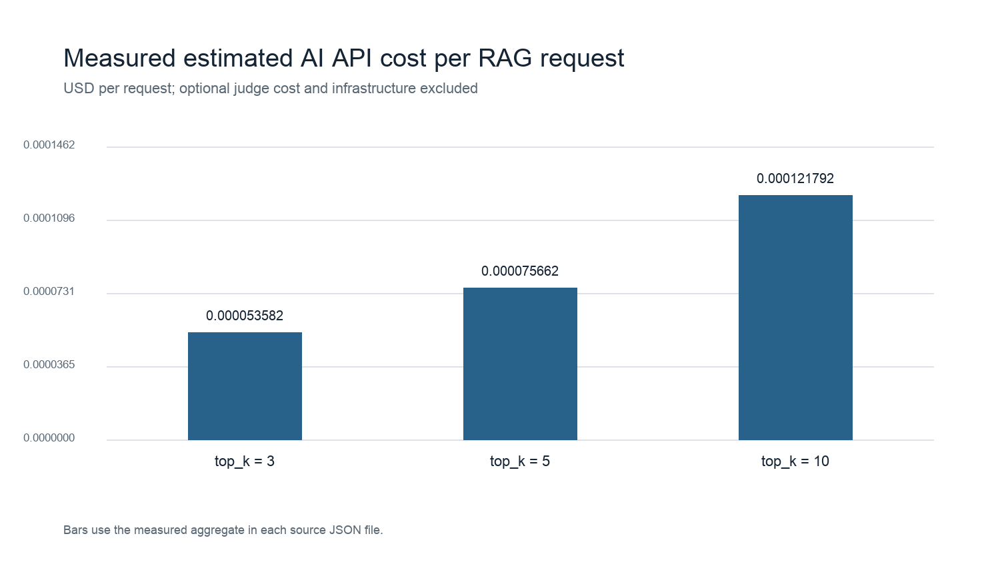
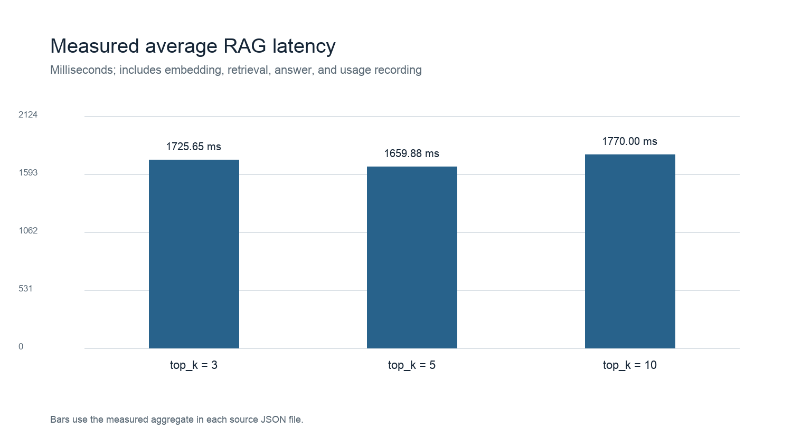
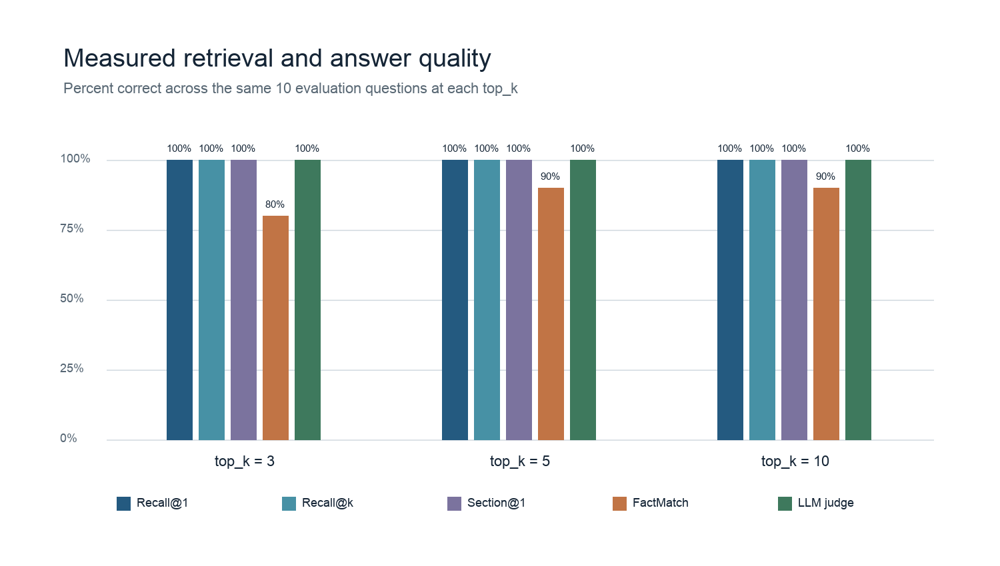

# OpsMind

OpsMind is an early backend prototype for an AI knowledge assistant. It ingests text-based PDFs, stores their chunks and embeddings in PostgreSQL, and answers questions using retrieved document context with numbered citations.

## What is implemented

| Endpoint | Purpose |
| --- | --- |
| `GET /health` | Service health check |
| `GET /api/version` | API version |
| `POST /chat` | Baseline LLM chat with usage metrics stored in PostgreSQL |
| `POST /documents` | PDF text extraction, duplicate detection, chunking, embedding, and storage |
| `POST /rag/chat` | Document-grounded answers with source metadata and cosine-distance scores |

The RAG endpoint searches the five closest chunks from ready documents. A request can include `document_id` to restrict retrieval to one uploaded PDF; without it, retrieval searches all ready documents. Source metadata comes from PostgreSQL, and the answer uses numbered citations such as `[1]`.

An [evaluation runner](backend/README.md#retrieval-evaluation) reports Recall@1, Recall@5, Section@1, and simple FactMatch scores, with an optional semantic OpenAI judge. The committed cases target the local evaluation PDFs and their document IDs; update those IDs when using a different database.

## RAG benchmark and estimated AI API cost

One run of 10 synthetic questions across 4 synthetic documents compared retrieval depths of 3, 5, and 10 chunks. The table uses the saved [benchmark results](backend/benchmarks/results/report.md); costs exclude infrastructure and optional LLM-judge calls.

| top_k | Recall@1 | Recall@k | Section@1 | FactMatch | LLM judge | Avg RAG latency (ms) | Est. AI API cost/request (USD) |
| ---: | ---: | ---: | ---: | ---: | ---: | ---: | ---: |
| 3 | 100% | 100% | 100% | 80% | 100% | 1725.6537625 | $0.000053582 |
| 5 | 100% | 100% | 100% | 90% | 100% | 1659.8823541999998 | $0.000075662 |
| 10 | 100% | 100% | 100% | 90% | 100% | 1770.0031 | $0.000121792 |

The API keeps `top_k=5`: it matched 10 on measured quality at lower estimated API cost and latency. This small, single-run benchmark is a starting point, not a general performance guarantee. See the [backend benchmark explanation](backend/README.md#ai-finops--rag-benchmark), [summary CSV](backend/benchmarks/results/summary.csv), and [monthly cost projection](backend/benchmarks/results/monthly_api_projection.csv).

## Stack and scope

Python, FastAPI, synchronous SQLAlchemy 2.x, PostgreSQL with pgvector, Alembic, and the OpenAI SDK. This is a local development prototype; authentication and production deployment are not implemented yet.

The original PDF is not retained. Text extraction does not use OCR. Questions and retrieved document text are sent to the configured OpenAI API when `/rag/chat` generates an answer.

## Run locally

See the [backend setup and API examples](backend/README.md) for environment variables, PostgreSQL and pgvector setup, migrations, running the server, uploading a PDF, and calling the endpoints.
